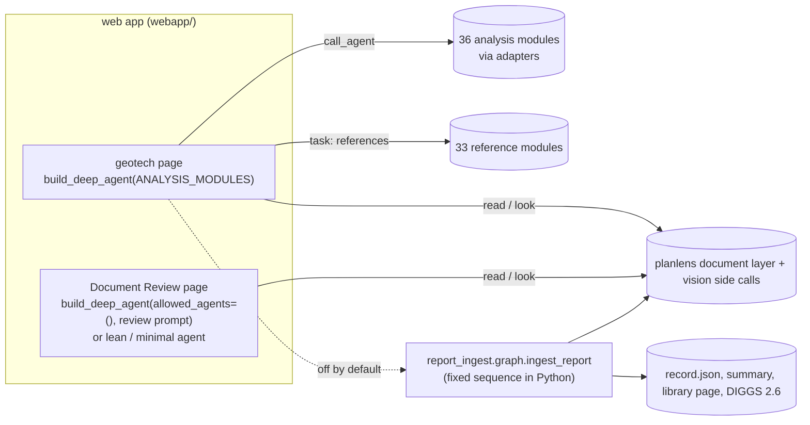

# How the AI harnesses work — theory of operation

This folder describes, from the code and from recorded runs, how the
project's AI harnesses actually work: who decides what happens next, what the
model is shown, what is fixed in code, how data flows, how runs fail and why.
It is written for the owner — an engineer, not a software developer — as a
lasting reference to build future work on. Opinions on what should change are
kept in a short "Observations" section at the end of each document; the body
is description.

Written 2026-10-04 against GeotechStaffEngineer commit `1085ddb` (branch
`release/5.32.0`, the 5.32.0 release commit; `funhouse_agent/` and `webapp/`
are identical to `23d7e33`, where reading began) and planlens commit
`999f82c` (branch `release/0.11.0`).
The recorded runs used released **5.31.0** (geotech evaluation, report
ingest) and pre-releases **5.32.0rc2/rc3** with planlens 0.11.0rc2 (Document
Review suite). Where the code has changed since those runs in a way that
matters, the documents say so.

### Changed since this was written

These changes date from 2026-10-07. They ship in app 5.32.1 with planlens
0.12.0: planlens 0.12.0 was released on 2026-10-08, and 5.32.1 is staged
and measured on Foundry (brief 4). The body text still
describes 5.32.0; short notes in the affected sections point here.

| Change | Commits | Affects |
|---|---|---|
| **Vision locations come back in pixels and are converted in code.** Each side call is told the image size and asks for `px=[…]` boxes; the tool rewrites them as 0-999 boxes with the size it SENT, so the agent still reads one convention. Old 0-999 answers still parse. | app `cf43c90` | `shared_machinery.md` §5.1; `locating_things_on_a_page.md` "What changed" |
| **No image is rendered larger than the host delivers.** The cap is 2,048 px on the long side by default (`GEOTECH_VISION_MAX_PX`). A fifth probe call measures the host's own limit. Zooms are padded by 10 % of the source view, and `tiles` accepts "NxN". | app `cf43c90` | `shared_machinery.md` §5.2 |
| **The markup check measures size.** The look returns the thing's box, and a mark counts as too wide only above 30× the thing's area. This replaced 5.32.0's model-judged "drawn closely" question, which rejected correct rings on GPT-5.4. | app `cc697e6`, `cf43c90` | `document_review.md` F3 |
| **planlens refuses a mark it cannot trust.** Two cases: a small mark read off a view wider than 300 pt, or an `image_box` that is the whole view. Separately, a quote on a multi-line CAD text block now lands on its printed row. | planlens `08a1d53` | `document_review.md`; `locating_things_on_a_page.md` |
| **`find_like` runs without OpenCV.** A numpy matcher gives the same hits; it is chosen where OpenCV cannot load (Foundry and Funhouse are both FIPS hosts). | planlens `d7d6657`, app `ba12760` | `document_review.md` §3 tools table |
| **The activity log keeps the model's own words.** `model_end` carries `text` and `reasoning`; `turn_start` carries the per-turn files note. | app `f405765`, `3d1cd44` | `shared_machinery.md` §3.4 |
| **Every turn starts with a note of the files the conversation holds.** It is added to that turn's message only. | app `3d1cd44` | `shared_machinery.md` §3.3 |
| **`subsurface.write_diggs`.** It writes real DIGGS 2.6 with the schema and read-back gates. | app `3d1cd44` | `geotech_agent.md` §3.1 |
| **Empty scratch searches say what they did not search.** | app `3d1cd44` | `geotech_agent.md` §7 |

The geotech-page field session that prompted the last four is written up in
`module_work/field_feedback/2026-10-06_geotech-report-session_v5.32.0/FINDINGS.md`.

**After 5.32.1: on master for the next release (unreleased, 2026-10-08).**
Plan of record: `module_work/SCALES_COVERAGE_CROSSCHECKS.md`. These change
what the documents describe only where a switch is on, or where noted.

| Change | Commits | Affects |
|---|---|---|
| **The DIGGS 2.6 schema ships with the package** and is checked with lxml on every host, with no pydiggs; `write_diggs` really checks the schema on the cluster | app `499e1cf` | `geotech_agent.md` (DIGGS) |
| **`write_diggs` runs report ingest's reconciler first**, linking lab tests to borings and comparing a summary table with its sheets, and returns `cross_checks`. It never changes a value | app `438430f` | `geotech_agent.md`; `report_ingest.md` (the reconciler is now used outside the pipeline) |
| **Coverage in code**, behind `GEOTECH_COVERAGE`, OFF: a ledger of every page any tool or helper read, `document_coverage`, and a once-only gate when an extraction turn tries to finish with data pages unread | app `6c81cc5` | `shared_machinery.md` §3, §4; both agent documents |
| **Step limits by turn kind**, with the coverage switch: an ordinary turn keeps the app's cap and ends with an answer there; an extraction turn may run to 150 | app `c9d5c8d` | `shared_machinery.md` §4.3 |
| **The report-review checklist**, behind `GEOTECH_REVIEW_CHECKLIST`, OFF; a DRAFT the owner is marking up | app `6c81cc5` | both agent documents |
| **The activity log writes each line under a lock.** Parallel tool calls were losing records; earlier traces with parallel page looks may be missing lines | app `6c81cc5` | `shared_machinery.md` §3.4 |
| **Visual scales in planlens:** `find_scales`, `measure`, and `log_grid` on scanned logs. NOT yet on either agent's tool list | planlens `a3f2a1d` | `locating_things_on_a_page.md`; `report_ingest.md` (`log_grid`) |
| **Visual scales in the app** (W3 steps 6-8; `VISUAL_SCALES_DESIGN.md` §12). `measure` and `log_grid` are agent tools on the geotech page and the Document Review legacy and lean builds (lean: its reading helper too), NOT the minimal build; they describe themselves and no prompt names them. `measure` takes a look's `view` + `image_box`, searched within that view's location error. A scan's label values are read by ONE vision side call over numbered crops, kept as printed and remembered per page (`scale_labels.py`). Every look's precision line now ends "a box read off an image locates a thing; it is not a measurement". `read_reference_figure` asks for `READ` lines with pixel boxes and returns `code_reading`: code's value +/- beside the vision value, flagged past 3x code's +/- (`GEOTECH_CHART_CODE_VOTER=0` turns it off). Report ingest, behind `GEOTECH_INGEST_VISUAL_SCALES`, OFF: measured layer tops vote (and enter the floor on scans with text), a `plot_vs_table` QA check on grading sheets, a code reading of digitised sounding traces, one `zoom_plot`. Off, the pixel-found layer boundaries are folded back. planlens: the pair search vectorised, per-page memo, `near`, printed label values, `log_grid(values=)` | committed 2026-10-08; released in 5.33.0 | `shared_machinery.md` §5 (the side calls, the precision line); `document_review.md` and `geotech_agent.md` (tool lists); `report_ingest.md` (log floor, lab, sounding, `zoom_plot`); `locating_things_on_a_page.md` |
| **Turned lettering, cut lines, sideways boxes (VIS-01, VIS-04, VIS-05; 2026-10-14).** A view whose text layer runs one turned way is sent turned upright, and its boxes are turned back. Every location request says to give boxes in the image as sent. A zoom takes in whole the lines its edges cut, and is told of the rest. `turn` on `analyze_pdf_page` / `render_region`, in their own descriptions. Behind `GEOTECH_VISION_TURN_RETRY`, OFF (arm `turn_retry`): a look that finds its lettering turned is read again upright, and a page found turned is sent turned | app `c9febc8`, `46e2736` (unreleased) | `locating_things_on_a_page.md` "What changed (2026-10-14)"; `shared_machinery.md` §5 (the side calls) |
| **Image files get zoom and tiles (VIS-09; 2026-10-14).** `render_region` takes an image as `attachment_key` (boxes in the image's own pixels); `analyze_image` gains `tiles` and `turn`; crops are cut from the original and enlarged only by whole numbers; `analyze_pdf_page` on an image file looks at it as an image | app `d1bc722` (unreleased) | `locating_things_on_a_page.md` "What changed (2026-10-14, … image files)"; `document_review.md` and `geotech_agent.md` (tool lists) |
| **Review page (DR-04, DR-15, DR-16; 2026-10-14).** The default review page no longer offers `read_reference_figure` / `view_worked_example_source`; the markup check says keep correcting, up to 4 checks of a copy, then name the unconfirmed marks, and returns `found_bbox` for a misplaced ring or box. planlens: distinct stroke-drawn sheets no longer called duplicates, and the duplicate-mark note says a repeat may hide an unmarked thing (PL-07, DR-17) | app `077192c`, planlens `89711ea` (both unreleased) | `document_review.md` (tools, F3) |
| **Long turns keep their work and wait out busy refusals (TA-19 to TA-22; 2026-10-14).** An errored turn's tool results become replayable history; a stopped helper's reading goes to `kept/helper_*.md`; at most 2 helpers at once; a 30-call helper budget; agent model calls retried on busy refusals (15/30/60/120 s, 5 tries, 900 s a turn); an optional per-key token pacer | app `6ffa347`, `8cd38f4` (unreleased) | `shared_machinery.md` §3.3, §5.4; `geotech_agent.md` (helpers) |
| **The record answers cost, cause and who did what (EV-14; 2026-10-14).** Token use on the Prompter route; helper ids on nested events; 429 status, headers and tries; engine and policy in `meta.json`; queue times; cut payloads kept whole | app `4dee54a` (unreleased) | `shared_machinery.md` §3.4 |
| **DIGGS writer and reader (RI-27; 2026-10-14).** Groundwater "not encountered" is never written as a reading; an unknown position is written as NaN and read back as None (never 0); a printed refusal in `n` becomes a refusal row with its text kept | app `d81c1f8` (unreleased) | `geotech_agent.md` (DIGGS); `report_ingest.md` |
| **The default review page (DR-01 to DR-03; 2026-10-12).** Its zoom tool's description no longer names tools the page lacks; its `task` helper carries the review's reading rules, the read-only tools and a 14-call budget; the page has a 40-call budget whose last call answers from what was gathered (`GEOTECH_REVIEW_MAX_MODEL_CALLS`; `off` restores the step cap alone). The scratch-filesystem tools were already off this page (live smoke wave 2b, released in 5.33.0) | app `ae50842` (unreleased) | `document_review.md` §2, §3.2, §4.4; `shared_machinery.md` §4.2 |
| **Model requests have a time limit; the reviewer has a budget (TA-26, TA-25; 2026-10-14).** A request gives up after 180 s on the Prompter key route and 600 s on the Foundry proxy and Anthropic routes (langchain handed the SDK no limit, and one request the gateway never answered held a helper 3.5 hours); a timeout is retried as busy. The `reviewer` helper gets a 10-call budget and its description says it sees only its brief | app `86879e8`, `95b6388` (unreleased) | `shared_machinery.md` §4.2, §5.4, §6; `geotech_agent.md` §3.4 |
| **`write_diggs` takes records from files (RI-28, RI-31; 2026-10-14).** Records may come from JSON files a helper saved (`investigations_file` / `lab_tests_file`), and a `task` result whose helper saved files names them; a depth read off a log's drawn scale counts as read; new cross-checks of drives against the sample interval, drive counts against the log's form, and readings below the hole's depth. planlens `log_grid` reads each sample's interval off the drawn boxes and returns compact rows (PL-24; feature-detected, reaches the app with the next planlens release) | app `89df4e6`, `76e8a56`; planlens `14dac18` (all unreleased) | `geotech_agent.md` §3.1, §3.4; `report_ingest.md` §4 (the reconciler) |
| **deepagents 0.7's `delete` tool hidden (INF-10; 2026-10-14).** It reached the review page's menu, its reading helper and the references consult; it is now hidden with the other scratch tools | app `6388489` (unreleased) | `shared_machinery.md` §2.1; `document_review.md` §3.2 |
| **Earlier turns' work reaches the helpers (TA-28; 2026-10-15).** An interrupted turn's new files get download cards and are named in the next turn's files note. `kept_readings`, a read-only tool, lists the conversation's kept page readings by reference and returns one whole by page: on the geotech page for the primary and its helpers, on the review page only behind `GEOTECH_REVIEW_KEPT_READINGS`, OFF (arm `kept_readings`) | app `642bd36` (unreleased) | `shared_machinery.md` §3.3; `document_review.md` §3.2; `geotech_agent.md` §3.2 |
| **Cited pages checked (EV-18; 2026-10-15).** After each turn the pages an answer cites are checked against the pages any tool or helper read or looked at, and a `cited_pages` event is always recorded; `GEOTECH_CITED_PAGES` (`note` / `retry`), OFF, acts on it. `write_diggs` adds a `page_not_read` cross-check and `record_finding` returns `pages_not_opened` | app `08bd8d4` (unreleased) | `shared_machinery.md` §3.4; `geotech_agent.md` §3.1 |
| **Marks and `find_like` on an image work in its own pixels (VIS-26; 2026-10-15).** A new marked copy of an image is a PDF whose page is the image at 1 pt a pixel; a mark centred off the image (or off a PDF's page) is refused, naming the size; `find_like` searches an image at its own resolution, EXIF applied, and returns pixel boxes | app `fde2df1` (unreleased) | `locating_things_on_a_page.md` "What changed (2026-10-14, … image files)" |
| **The Foundry brief 4 fixes** (uncommitted on 2026-10-08, to be measured before they ship; TRACE_REVIEW §9 of `review_eval_results/2026-10-07_foundry_5.32.1rc3/`). The markup check names the thing apart from the comment (`target` / label / quote), checks EVERY anchor (quotes and notes too) and measures enclosure. An agent's `dpi` is not used under a budget. `annotate_document` reads `color`, `comment`/`text` kinds and a nested `anchor`, and flags one thing marked twice. A tiled page look lists what only the tiles found. A zoom says how far its answer is from its aim. Readings are a best reading, brackets only where truly ambiguous. `find_like` drops linework crossing its example and reads nothing when a page floods. The suite checks where a comment points. Responses calls ask for a reasoning summary; run.json names commits and the vision profile. RESULTS.md prints floor / model (and lab "read") beside before / after. Behind a switch, OFF: images padded to whole 32 px patches (`GEOTECH_VISION_PATCH_ALIGN`) | app `cc36945`, planlens `cbca2ec`; released in 5.33.0 | `document_review.md` F3; `shared_machinery.md` §3.4, §5; `locating_things_on_a_page.md`; `report_ingest.md` (scoring) |

---

## The three harnesses, and how they relate

| | GeotechStaffEngineer agent | Document Review agent | Report-ingest pipeline |
|---|---|---|---|
| What it does | Answers geotechnical questions by running the package's analysis modules and consulting the design references | Answers questions about any uploaded PDF by reading its text and looking at its pages; writes memos and marked-up PDFs | Turns one geotechnical report PDF into a structured, cited record and its exports (summary, library page, DIGGS 2.6 XML) |
| Who decides the next step | **the model** (tool-calling loop) | **the model** (tool-calling loop) | **Python** (a fixed sequence); models are called for bounded jobs inside it |
| Built on | deepagents / LangChain `build_deep_agent` | the same builder (default), or a lean/minimal LangChain agent behind a switch | its own engine layer (`report_ingest/engine.py`), planlens, no agent framework |
| Where it runs | web app, geotech page | web app, Document Review page (the default page) | notebook cell `score_on_cluster`, or as a sub-agent of the geotech agent (off by default) |
| Its evaluation | `funhouse_agent/deep/eval_harness.py` (106 questions) | `funhouse_agent/review_eval/` (42 tasks, switchable arms) | `report_ingest/cluster_scoring.py` (stages against hand truth) |
| Recorded evidence | `b2all/geotech_eval/` | `brief3/out_sol_532/` + `module_work/review_eval_results/` | `b2all/stage_b…e/` |
| Document | `geotech_agent.md` | `document_review.md` | `report_ingest.md` |

The two agents share almost all of their machinery — the builder, the
tool-result caps, the vision tools and their "side call", the planlens
document tools, the web app's turn handling — described once in
`shared_machinery.md`. In its default form the Document Review agent **is**
the geotechnical agent with the analysis modules taken away and the prompt
replaced.

The report-ingest pipeline is a different kind of thing: a deterministic
program that calls models, not a model that calls programs. It touches the
agents in two places only: it can be attached to the geotech agent as a
sub-agent with no model of its own (`report_ingest/subagent.py`), and a
second small agent (`report_library`, `report_ingest/library_agent.py`)
answers questions across reports already ingested. Both are off by default.

---

## Reading guide

1. **`shared_machinery.md`** — read first. The tool-calling loop, what a
   model call contains, what persists between calls and between turns, the
   result-size caps, model-call budgets and step caps, and the "eyes": how a
   page becomes an image, how big, and why the reasoning model usually never
   sees it.
2. **`document_review.md`** — the Document Review page: its three agent
   builds, its prompt and tools, the evaluation suite, and the eight failure
   modes visible in the brief-3 traces.
3. **`geotech_agent.md`** — the geotechnical agent: catalog, dispatch,
   sub-agents, and the eight failure modes visible in the 106-question run.
4. **`report_ingest.md`** — the pipeline: stage sequence, every kind of model
   call and what it is shown, the floor-and-model merge, the writers, the
   scoring harness, and what the recorded stages show.
5. **`locating_things_on_a_page.md`** (added 2026-10-07) — how the Document
   Review agent finds WHERE something is on a page, route by route; the
   conversion math checked; the measured error of every route against the
   synthetic fixtures (whole-page boxes come back as a shrunken copy of the
   truth — a property of the vision models, not of the conversion — while
   zooms land within a few points); and a notebook cell that measures it on
   Funhouse.

Each harness document has the same sections: boundaries; what the model is
shown; control loop; deterministic versus model; data path; failure modes
with mechanisms and evidence; invariants; open questions; observations.

---

## How the evidence was used

* **Code** is cited as `path:line` in this repository at `1085ddb` unless a
  version is named (`v5.31.0:` for what ran in brief 2). planlens is cited as `planlens/...` in its own repository.
* **Recorded runs** are kept in
  `module_work/field_feedback/2026-10-04_foundry_evidence/raw/` (gitignored:
  they hold values read out of the client reports, so they are local only and
  never committed): `b2all/` (brief 2: 5.31.0 report ingest stages b–e and
  the geotech evaluation) and `brief3/` (5.32 Document Review suite). Paths
  in the documents are relative to that folder. The committed copies of the
  result TABLES are in `module_work/review_eval_results/`; the traces are not
  committed.
* **Sampling** is stated in each document. In short: for the two agents,
  every failed task or keyed question was read in full and selected passing
  runs were read for contrast; for report ingest, the stage tables, every
  per-report run and QA file (by counts) and selected item files were read;
  everything countable (tool calls, model calls, tokens, zoom outcomes, QA
  kinds) was counted by script over all runs.
* **Prompts as the model sees them** were rendered offline by building each
  agent around a recording fake model (no network) and capturing its first
  request; sizes quoted are from that render on the local install (deepagents
  0.6.8), which differs in detail from the Foundry install (0.7.13).
* **Hard rules followed**: no content from client reports (reports are named
  R09, R21…; measurements are counts and rates), no hostnames, dataset paths
  or credentials (several log files contain them), nothing from any `raw/`
  folder, tokens and seconds rather than dollars.

---

## Glossary

| Term | Meaning here |
|---|---|
| **agent / harness** | A model plus the code around it that decides what it sees, what it may call, and when it stops. |
| **model call** | One request to the language model: system prompt + messages + tool schemas in, text and/or tool calls out. |
| **tool** | A Python function the model may ask to run, described to it by a name, a description and a parameter schema. Its result comes back as text. |
| **turn** | Everything between a user message and the answer: usually several model calls and tool calls. |
| **sub-agent** | A second agent the primary hands a self-contained job to through the `task` tool; it sees only the job description and returns one message. |
| **side call** | A one-shot model call made INSIDE a vision tool: one image + one prompt, no conversation. Its text is the tool's result. |
| **inline image** | The alternative to a side call (switch-gated): the image is put in front of the reasoning model itself at its next call. |
| **budget** | A limit on model calls that ends gracefully (the last call must answer). |
| **step cap / recursion limit** | LangGraph's limit on graph steps; hitting it raises an error. |
| **floor** | In report ingest: what the deterministic reader (log grid, lab tables, calc patterns) found before any model call; the model may add and correct with evidence, never drop. |
| **arm** | In the review suite: a named set of switches, run over the same tasks for comparison. |
| **brief 2 / brief 3** | The two recorded Foundry campaigns (5.31.0; 5.32.0rc2/rc3). |
| **0-based / viewer page** | Tools count pages from 0; a PDF viewer and every citation count from 1. |

---

## The central picture, in one paragraph

All three harnesses rest on the same division of labour — let code do what
code can do exactly (text extraction, page classification by rules,
arithmetic, units, file writing, result-size discipline) and ask a model only
for judgement — but they draw the line in different places. In the two agents
the MODEL holds the plan: it chooses modules, pages, prompts and when to stop,
and code only shapes what it can see and caps what it may spend. In report
ingest CODE holds the plan, and models fill bounded slots under a rule that
keeps the deterministic reading as a floor. The recorded failures cluster at
boundaries where information has to cross from one model call to another, or
between a model and code: a location carried as 0-999 numbers in prose from a
vision side call to the reasoning model; a capability that exists in code but
not in the one-line catalog the model reads; a "verification" done by the same
model on the same image that made the claim; a checker the agent learns to
satisfy rather than the task; a structured answer that does not fit its
output limit; a label policy measured on one set of reports and applied to
another; and scorers that measured a different slot from the one the product
filled. Each harness document traces these to the lines of code involved.

---

## The findings that matter most for future work

1. **The vision side-call boundary** (`shared_machinery.md` §5.1,
   `document_review.md` F1-F3). The reasoning model never sees a page by
   default; it reads another call's prose, and every location it acts on is a
   number it copied out of that prose. About a third of zooms built that way
   missed their target; a look-alike read once was "verified" by the same
   reader; and a model-judged markup check was satisfied by widening rings.
2. **The catalog is the agent's whole map** (`geotech_agent.md` G1-G3). Three
   of six keyed failures in the 106-question run were capabilities that
   exist but are named in no catalog or method brief the model reads; when
   the model gives up looking it computes by hand, against its own prompt.
3. **Measurement is the weak link in report ingest** (`report_ingest.md`
   P1-P3, P7). One structured answer that overflowed its token limit failed a
   whole report; the default label policy lowered accuracy on the reports it
   was run on; the largest apparent reader losses were scorer faults; two
   readers have no blind test at all.
